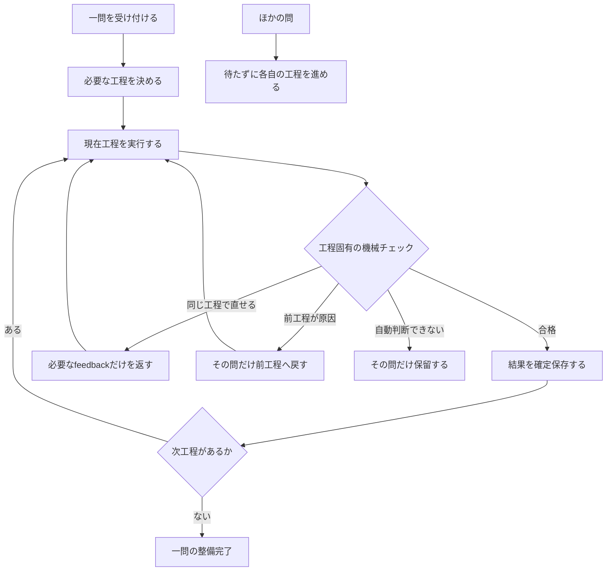

# 問題整備ワークフロー

この文書は、`exam_scraper`で問題を取得してから公開するまでの**唯一の入口**です。ここには全体の順序と各正本の要旨だけを置き、field、コマンド、UI、法令監査などの詳細はリンク先で管理します。

## 全体フロー

1. **入力・保護**：取得問題は`資格・取得設定` → `scrape`、最初から自作する問題は[独自問題作成ワークフロー](original_question_authoring_workflow.md#最初から自作する問題)（`import_authored_original_questions.py`）→ **`00_source`**（現在スナップショットとして保護）
2. **整備**：公式過去問は`01〜03` ／ それ以外・混在は`05 独自問題化`（本文・選択肢・正答・必要画像を確定）→ `01〜03`
3. **資格別の後工程**：`03b 現行法監査`（`law_workflow_enabled=false`の資格は02b・03bを省略）→ `03c category.json（未準備時）` → `04 問題集`
4. **公開前検査**：`merge / convert` → `quality-gate / upload dry-run` → **評価待ち**
5. **評価・反映**：問題ごとの別sessionで評価 → **合格：明示操作でFirestore反映＋直後readback** ／ **不合格：再整備session後に新sessionで再評価**
6. **継続改善（モデル進化時の再監査）**：整備・公開済みデータを[既存パッチの再監査・差分更新](patch_reaudit_workflow.md)で盲検点検し、前回見逃した誤りや解説改善点がある問題だけパッチを差分更新する

## 一問整備の基本仕様

> **一問 = 問題文 + 全選択肢 + 正答 + 解説**

問題整備システム（[実行境界](local_question_review_console.md#一問queueとsession)）は、トップの`listGroupId`一覧から対象年度・整備項目・対象問題（通常は`整備が必要な問題だけ`）・対象数（1〜500問）を受け取り、最大500個の処理枠で一問ごとに独立して整備します。

- **同じ問の中では順番を守る。** 問題文と全選択肢の作業がそろい、機械チェックと確定保存が終わるまで、その問の一部を次工程へ渡さない。
- **問同士では待ち合わせない。** ある問が再試行中又は保留中でも、ほかの問は進める（資格方針・カテゴリ・公開準備などの共有工程だけで待ち合わせる）。

- 工程順・適用条件・prompt・更新範囲・機械チェックはworkflow設定で一元管理し、一問には同時に一工程だけを動かして必要な現在内容・根拠・feedbackだけを渡す。
- 中断後は確定済み工程を保持して最初の未完了工程から再開し、前工程変更時は影響する後続工程だけをやり直す。`hold`は同じ入力のまま無限再試行せず、一次根拠・正本・工程版の更新後に自動選定して再開する。性能・品質分析のため、処理時間・待ち時間・再試行や保留の理由・同時実行数・工程版・入出力fingerprintを一問・一工程単位で記録する。

## 正本マップ

| 関心事 | 正本 | 要旨 |
| --- | --- | --- |
| 資格追加・スクレイピング | [scraping_workflow.md](scraping_workflow.md) | preset、scraper実装、ID、画像、`00_source`の取得・更新・保護条件を定義する。 |
| 独自問題 | [original_question_authoring_workflow.md](original_question_authoring_workflow.md) | 取得問題の05独自問題化と、最初から自作する問題の登録・公開条件を定義する。 |
| 工程順・名称・正本文書 | [../../config/question_maintenance_workflow.toml](../../config/question_maintenance_workflow.toml) | 問題整備システムの工程カタログを一元管理する。 |
| 人間判断prompt | [../../prompt/README.md](../../prompt/README.md) | 各promptが所有する判断方法と実行境界への入口。 |
| 資格固有資料 | [../../prompt/qualification_docs/README.md](../../prompt/qualification_docs/README.md) | 出題範囲、取得事情、分類、法令スコープと解説の資格固有調整を定義する。 |
| category.json | [../../prompt/qualification_docs/category_taxonomy_policy.md](../../prompt/qualification_docs/category_taxonomy_policy.md) | 03cで作る資格単位taxonomyの根拠、ID、検証方法を定義する。 |
| 保存先・ファイル名 | [artifact_contract.md](artifact_contract.md) | source、patch、merged、convert、review artifactの責務を定義する。 |
| field・型・必須性 | [../reference/question_field_contract.md](../reference/question_field_contract.md) | Firestoreへ至る共通field契約を定義する。 |
| 現行法監査 | [current_law_question_maintenance_workflow.md](current_law_question_maintenance_workflow.md) | 公的一次情報の取得と一次・二次・三次監査を定義する。 |
| 機械検証CLI | [../../tools/question_bank/README.md](../../tools/question_bank/README.md) | `quality-gate`など、日常的に実行するCLIの使い方を定義する。 |
| merge・convert・公開 | [delivery_workflow.md](delivery_workflow.md) | upload-ready生成、機械gate、品質確認gate、Storage・Firestore反映とreadbackを定義する。 |
| 問題整備システム | [local_question_review_console.md](local_question_review_console.md) | 複数問題の整備、後日の複数選択評価、問題ごとのFirestore反映と安全境界を定義する。 |
| バッチ成果物モニター | [batch_artifact_monitor.md](batch_artifact_monitor.md) | 並列稼働、保存済み成果物、公開Agent活動をread-onlyで観測する境界を定義する。 |
| 作業バージョン | [local_question_review_console.md#作業バージョン](local_question_review_console.md#作業バージョン) | MAJORで洗い替え、MINORで洗い替え不要の改訂を管理する。 |
| 既存パッチの再監査・差分更新 | [patch_reaudit_workflow.md](patch_reaudit_workflow.md) | 次世代モデルによる盲検再判定、対象問題のピンポイント差分更新、知見還元ルールを定義する。 |
| ユーザーフィードバック対応システム | [user_feedback_response_system.md](user_feedback_response_system.md) | 日次タスク消化、独立サブエージェント承認と限定公開の運用を定義する。 |
| 公式問題の問題報告 | [question_issue_report_workflow.md](question_issue_report_workflow.md) | blind review、correction overlay、限定公開の手順を定義する。 |
| Lawzilla利用評価 | [lawzilla_mcp_practical_review_workflow.md](lawzilla_mcp_practical_review_workflow.md) | Lawzillaの検索品質と改善点を記録するschemaを定義する。 |
| 一時資料 | [../temporary/README.md](../temporary/README.md) | 日付付き監査、移行記録、単発レビューの置き場所と削除基準。 |

## 全工程に共通する境界と更新ルール

- `00_source`は手作業・AI・後工程で編集・削除・改名しない。人間・AIの判断は責務に合うpatchへ保存し、merged・convert・upload-readyを直接編集しない。
- 問題文と選択肢を結合した完全命題を一問ずつ確認し、既存ID（`questionId`、`originalQuestionId`、`questionSetId`）を理由なく変更しない。判断不能はreview sidecar又は`hold`へ送る。
- 適用工程と別session評価が現行MAJORで揃った問題だけを、依頼又はUIの明示確認の下でFirestoreへ書き込む。
- **文書更新ルール**：仕様変更はその仕様を所有する正本1ファイルだけへ書き、この幹には順序・責務・リンク先が変わる場合だけ1〜2文の要旨を置く。日付依存の調査・完了記録・goal・receiptは仕様根拠にせず、必要な結論だけを恒久正本へ反映する。
