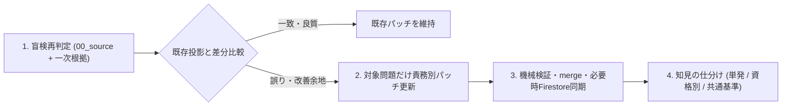

# 既存パッチの再監査・差分更新ワークフロー

AIモデルの進化や判定基準の洗練に伴い、整備・公開済みの問題データ（例：`shinkyu`等の過去問パッチ）を改めて点検し、前回は見逃した正答・形式・意図の誤りや不十分な解説を検出して、必要な問題だけパッチを差分更新する手順の正本です。各工程の判定基準は[問題整備prompt](../../prompt/README.md)、保存先は[artifact契約](artifact_contract.md)、公開手順は[merge・検証・公開](delivery_workflow.md)を参照します。

## 基本原則

- **既存パッチの結論を前提にしない（盲検再判定）**: 既存の`correctChoiceText`や`explanationText`を正解として読むと、前回の誤りを追認しやすい。最初に`00_source`と一次根拠だけから答えと理由を独立に導き、その後に既存パッチと照合する。
- **問題ない大多数は書き換えない（ピンポイント差分更新）**: すでに正確で読みやすい問題まで全面再生成すると、不要な差分や新たな退行を招く。独立判定との比較で「誤り」又は「明確な改善価値」が確認された問題だけを更新対象に絞る。
- **不変条件の厳守**: `00_source`、既存の`questionId`・`originalQuestionId`・`questionSetId`は変更しない。配列インデックス順（`enumerate`等）による機械的な一括流し込みを禁止し、更新対象は1問ずつ本文・選択肢・正答・解説を目視照合して確定する。

## 手順



### 1. 盲検による独立再監査と更新対象の抽出

対象年度（`listGroupId`）の`00_source`（問題文・選択肢・図表・公式解答）と資格固有資料・一次根拠だけを入力とし、次世代モデルで全選択肢の命題真偽、回答操作（`questionType` / `isCalculationQuestion`）、設問意図（`questionIntent`）、核心論点を独立に導出します。導出結果を現在の論理投影（`logicalProjection`）と突き合わせ、次のいずれかに当たる問題だけを更新対象として抽出します。

1. **重大不整合（最優先で更新）**: `correctChoiceText`、`questionType`、`isCalculationQuestion`、`questionIntent`、現行法判定（`03b`）の誤り、別問題の解答・解説の混入、又は解説内の事実誤認・根拠条文の誤り。
2. **解説の品質改善（対象を絞って更新）**: 結論は正しいが、誤答理由の飛躍、正しい選択肢本文の丸ごと再掲、作業メモ調の表現（`〜である点が誤り`等）、途中計算や変数説明の欠落があり、初学者が一度で理解できない解説。

### 2. 責務別パッチのピンポイント差分更新

抽出した問題だけを1問ずつ確認し、変更するfieldを所有するパッチ層だけを更新します。`12_merged_questionType`、`20_merged_1`、`30_merged_2`、`40_convert`、`upload_to_firestore`は生成物のため直接編集しません。

- **所有層の対応**: 問題形式・計算フラグは`10_questionType_fixed`、設問意図は`15_correctChoiceText_fixed`、正答配列は`23_correctChoiceText_fixed`、法令根拠候補は`18_law_context_prepared`、学習パターン・解説・補足質問・法令監査factsは`21_explanationText_added`（03b対象は監査sidecarも同期）、単元分類は`22_questionSetId_linked`を更新する。公式問題冊子との照合による本文・選択肢の誤記補正だけは`24_questionIssueCorrections`で扱う。
- **連動更新**: `10`で問題形式（例：`true_false`と`flash_card` / `group_choice`）を変えた場合、又は`23`で`correctChoiceText`を変えた場合は、同じ問の`21`（解説の件数・冒頭判定・説明内容）も同時に更新して整合させる。
- **実行経路の選択**:
  - **GUI運用資格**: [問題整備システム](local_question_review_console.md#評価と公開の安全境界)の`評価・公開`で別session評価を実行し、`要再整備`となった問題・更新項目だけを選んで再整備runへ戻す。
  - **CLI・手動パッチ運用資格（例：`shinkyu`等）**: `sourceQuestionKey`・`reviewQuestionId`・`sourceRecordRef`（又は`original_question_id`）で対象レコードを特定し、該当パッチJSONの対象問題だけを更新する。

### 3. 機械検証と公開成果物の同期

パッチ更新後は、次の検査をすべて通してエラー0件を確認します。1件でもエラーが出た場合は推測で補正せず、`00_source`の正本と一次根拠へ立ち返って原因を特定します。

```bash
# 1. 00_source不変と正答パッチ整合の検証
python3 scripts/check/check_00_source_immutability.py
python3 scripts/check/check_correct_choice_patch_coverage.py --qualification <qualification> --require-full

# 2. merge・convert・upload dry-run と merged 必須検査
python3 scripts/pipeline/prepare_firestore_upload.py <list_group_id> -b output/<qualification>/questions_json --upload-dry-run
python3 scripts/check/check_choice_text_alignment.py --base-dir output/<qualification>/questions_json --stage merged
python3 scripts/check/check_required_fields.py --base-dir output/<qualification>/questions_json --stage merged
python3 tools/question_bank/question_bank.py quality-gate --qualification <qualification> --list-group-id <list_group_id>
```

Firestoreへ公開済みの資格では、[merge・検証・公開](delivery_workflow.md)に従い、差分のある問題だけを本番反映して直後の`readback`一致を確認します（`questionSetId`を変更した場合は`category.json`の件数同期も行う）。

### 4. 文書を肥大化させない知見還元ルール

再監査で検出した誤りの原因に応じて還元先を仕分け、共通プロンプトへ個別事例や禁止事項を際限なく追記しません。

| 検出した誤りの性質 | 対応方針 |
| --- | --- |
| モデルの推論力向上だけで解消した単発の見落とし | 対象パッチの差分更新だけで完了とし、プロンプトや運用文書は変更しない。 |
| 資格特有の専門用語・出題慣習・参照資料の知見 | `prompt/qualification_docs/<qualification>/README.md`（法令範囲は`*law_reference*.md`）へ簡潔に反映する。 |
| 複数資格に共通する判定基準の曖昧さ | 該当する共通prompt 1ファイルで、例外規定を足すのではなく既存の判定基準文をより単純・明快な表現へ書き換える。既存データの再点検が必要なら[`config/question_maintenance_workflow.toml`](../../config/question_maintenance_workflow.toml)の`policy_version`のMAJOR、今後の作業だけでよければMINORを上げる。 |
