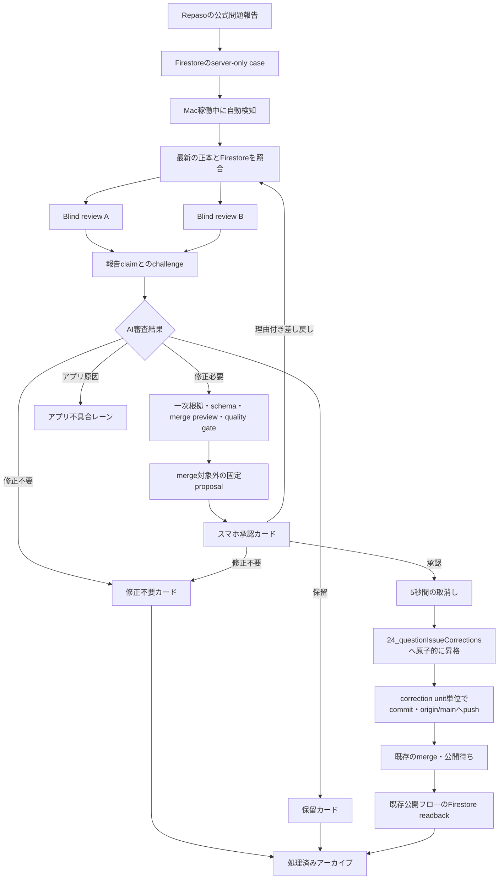

# ユーザーフィードバック対応システム

状態: 実装中。個別受付台帳と読み取り専用の日次照合を実装済み。日次heartbeatが既存CLIを使って調査・独立監査・公開を進める。専用の常駐GUIとスマホ承認画面は未実装。

最終更新: 2026-10-17

この文書は、Repasoから届くユーザーフィードバックの調査、改善、独立監査、patch保存、Firestore公開を扱う運用正本です。公式問題の誤り報告を修正レーンとし、AI解説への利用者質問から学習上のニーズを見つける改善レーンを置きます。将来はアプリ不具合、UI改善、要望も追加します。

専用の常駐審査サービスと自動patch昇格サービスはまだ実装されていません。日次heartbeatは[公式問題の問題報告workflow](question_issue_report_workflow.md)と[公開workflow](delivery_workflow.md)の既存CLIを使います。公式問題レーンのintake schema、blind review、許可field、`24_questionIssueCorrections`契約は同文書と[`config/question_issue_reports.json`](../../config/question_issue_reports.json)を再利用します。

## 日次自動処理の承認・公開方針

2026-10-11、ユーザーは既存・新規のフィードバックに必要な問題データの修正について、作成者とは別のサブエージェントの承認を条件に、正式patch保存からFirestore本番公開までを包括的に許可しました。日次処理では個別の人間承認や公開確認を待ちません。この文書の後段にある人間への提示・個別承認・スマホ承認画面・取消し期間・次回公開待ち・手動対応待ちは手動モードの設計資料であり、日次自動処理にはこの節を適用します。旧CLIの承認flagとreceiptも、独立監査の固定対象と今回の包括ユーザー許可に正確に対応させます。人間回答を必須とする機械契約は、監査結果で代用又は偽装せず、対応する実装を検証してから使用します。

日次処理は受付照合後、既存の未着手タスクを原則として古い順に進めます。正答・採点への影響等を理由に優先順位を変えた場合は理由を記録します。調査、改善案の作成、監査、正式保存、公開、読み戻しを区別し、登録や案の作成だけで完了にしません。

1. 一次根拠と現在のローカル正本・Firestoreを照合し、一問の本文、全選択肢、正答、解説、必要な画像・分類・回答形式を確認します。安定IDと`00_source`を維持し、責務に合うpatch層へ修正候補を作ります。
2. 対象task/case、資格・年度・原問・全sibling ID、対象fieldの変更前後、根拠locatorとhash、正本入力hash、差分hash、影響範囲、必要な検証、復元手順を固定します。
3. 作成者とは別の読み取り専用サブエージェントが、一次根拠から独立に監査します。公式報告のBlind A/B・Challenge、法令の三段階監査等、既存の必須レビューも維持します。承認には実際のサブエージェント識別、固定対象のhash、判定、根拠、未解決指摘0件を持つ監査結果を保存します。自己承認、合意数だけによる正当化、人間承認を装った記録は使いません。
4. 指摘を修正し、変更後の候補を再監査します。基準を緩めて承認を取得せず、同一入力・同一失敗の無限再試行もしません。根拠不足、判断の不一致、技術的な障害や競合で進めないタスクは理由と再開条件を残して保留し、ほかのタスクを進めます。
5. 独立監査で承認された同一差分だけを正式patchへ保存し、保存receipt、merge/convert、必須checker、quality gate、対象の独立評価、upload dry-runを確認します。patch保存後の公開artifactが承認対象から変わった場合は再監査します。必要な検証の失敗・未実行を承認で免除しません。
6. 公開直前に最新のFirestore値・document更新時刻と承認時の修正前値を照合します。承認済みの既存document・許可fieldだけを既存uploaderの限定書込みで反映し、対象外不変と全対象fieldのlive readback一致を確認して公開receiptを残します。競合を上書きせず最新入力へ戻って調査・監査を再実行します。
7. 公開後の読み戻しが一致したタスクだけを公開済みとします。書込み後の確認失敗は公開未確認としてreceiptと再開位置を保持し、再実行時に現在値を読み戻してから既存の公開再試行経路へ進めます。既存CLIがサブエージェント承認による正式保存・公開契約又は公開後の状態を受理できない場合は結果を偽装せず、実装不足を記録して該当工程を保留し、その対応を関連検証付きで進めます。検証済み公開receiptがある場合は別に保全します。

この包括承認はフィードバックに必要な問題データの修正・改善が対象です。アプリ配布、Firestore rules、権限、課金などの変更には拡張しません。差分や判断入力が変更された場合は旧監査承認を失効させます。既存の人間承認待ち候補も最新入力で監査し、上記条件を満たせば人間の返答を待たずに進めます。

日次設定は`~/.codex/automations/repaso/automation.toml`に保存されます。生の利用者本文・識別情報をGit、通常ログ、通知に載せず、進展、公開結果、保留・失敗等の必要な変化だけを通知します。

### 無人実行経路の既知の未対応

この方針と日次設定の更新は、すべての正式保存・公開経路の無人対応完了を意味しません。2026-10-12、`formal_correction_save.save_formal_units(..., subagent_approval=...)`に人間承認とは別の`native-independent-approval/v1`契約とv2保存receiptを追加しました。既存の限定immutable unitが対象であり、任意の問題や正式patch層をこのAPIへ流し込めるわけではありません。人間承認経路と法令再照合、exclusive保存、入力再検証は維持します。

`independent_approval`は親sessionの直接ユーザー包括許可、固定planを検証するCLIのnative出力、実委任のcallとSubAgentActivity、子identity、同じ暗号文の配送、親子turn、平文の構造化最終回答とtask_completeを照合します。暗号化された依頼本文を復号したとは扱いません。承認scopeは作者の検証出力と子の最終回答が一致した内容です。ローカルnative記録は暗号学的署名ではありません。作者と同一の監査者、未解決指摘、別scope、未完了turn、入力変更は拒否し、正式保存直前とreceipt読込時にも再検証します。

native作成callはCLIの正常終了まで、途中でyieldされた出力も連結して保持します。失敗時にはscopeを発行しません。実際のnative exec入力と同じ末尾改行を含めて固定し、入力bytesの厳密な照合は維持します。生成callを変更した旧plan・scopeは、そのままの承認再利用をせず再生成・再監査します。

改善previewは`--approval-mode independent`で`exact_diff_native_subagent_formal_save_approval`を要求します。候補を作るだけで正式保存済み・公開済みにはなりません。2026-10-13、ガスの`25_verified_publication`に対する一task・一年度・一既存documentの解説改善に専用CLI `tools.question_bank.feedback_verified_save`を追加しました。対象fieldは`explanationText`・`suggestedQuestions`・`suggestedQuestionDetails`だけです。公式indexとPDF現物、元bytes、候補再投影、一次根拠、全siblingのmasked snapshotとexact updateTime、task要件、実装依存を固定します。`prepare`はprivate planだけを作り、`scope --stage final`のnative作成出力と別subagentの承認から`save`へ進みます。法令対象では`scope --stage primary/secondary/tertiary`に対する三名の異なるnative監査者の証跡を順に`law-<stage>-approval.json`へ保存し、最終scopeにも全証跡hashを結合します。監査者は既存の三段階法令監査の内容条件を確認し、古い法令本文のhashだけで現行法確認を済ませません。保存直前はfresh readの後に入力・scope・native承認を再照合します。

この保存は元ファイルのexclusive退避と候補のexclusive確定を使い、`feedback-verified-explanation-save-receipt/v1`を残します。短い置換区間及び中断時には正本が不存在となるため、readerは失敗として停止します。bootstrapは既存又は復元中の25を上書きしません。第三値があれば上書き・自動rollbackせず元bytesと再開位置を保持します。`save`の同一再送と`restore`の中断復元を検証します。`restore`後は旧planを再保存せず新planを作ります。元の入力・根拠又は承認が変わって再検証できない場合は復元も保留し、新たな監査・復旧判断を必要とします。保存receiptは正式保存だけを証明し、Firestore公開を意味しません。詳しい保存境界は[artifact契約](artifact_contract.md)を参照してください。

2026-10-15、調査中に見つかった関連不備を`feedback_maintenance_tasks`で既存の私有台帳へ登録する経路を追加しました。共通引数`--repo-root <repo> --db <既存台帳>`に続けて`register --proposal <scope> --proposal-sha256 <hash> --audit <content監査> --audit-sha256 <hash> --creator-session-id <作者session>`を指定します。`inspect --task-id <ID>`で保存結果を読み戻します。登録は真正な別subagentの完了した内容監査、固定候補・差分・全sibling・一次根拠、既存改善taskの要件と結び付けます。同じ登録の再送は冪等で、入力変更・別task・履歴不整合は拒否します。現在の登録状態は`open`のみで、正式保存・公開・完了への状態遷移はまだ行いません。内容監査や登録を正式保存・公開の承認には流用しません。

同じ年度・原問の複数documentについて、登録済み差分だけを扱う専用plan `feedback-verified-maintenance-save/v1`とprivate patch `feedback-verified-maintenance-private-patch/v1`を追加しました。`feedback_verified_save prepare --maintenance-task-id <登録ID>`で既存改善taskの要件を維持し、説明fieldと既存`lawRevisionFacts.differenceFacts`の説明文だけを投影します。法令locator・判定・監査metadataは変えません。候補全体との完全一致、全siblingの書込みfield、修正前値とexact時刻を再確認します。従来の単一document schemaは複数document用に読み替えません。三段階法令監査と別subagentの最終native承認を経た同一候補だけ、既存のexclusive保存・中断復元経路を使い、専用`feedback-verified-maintenance-save-receipt/v1`を残します。このreceiptも公開の証明ではありません。

正式保存の台帳記録は、独立監査を通した専用CLI `python -m tools.question_bank.feedback_verified_save_record --repo-root <repo> --db <既存台帳> record --plan <保存plan>`で行います。`inspect --task-kind maintenance --task-id <登録ID>`で再検証して読み戻します。真正な保存receipt・native承認・元bytes・候補・正式正本・復元journal・固定入力と、現在の改善要件・maintenance登録を確認してから、`verified_formal_save_records`へ追記します。検証中の入力変更・競合・中断では記録を確定せず、同一再送は重複しません。生の利用者本文やnative session本文は保存しません。日々追記されるsession全体のhashは検証中の一時的な競合検知にだけ使い、保存記録には含めません。

この記録は`formally_saved`だけを表します。maintenance登録自体は変更できない`open`の受付根拠として保持し、summaryの`verifiedFormalSavesRecorded`で保存証跡を別に数えます。改善taskを完了へ移したり、Firestore公開・readbackを証明したりする経路ではありません。

未対応なのは、新25保存receiptを使う真正checkpoint・独立評価・限定公開・公開完了記録のadapter、複数task/年度/原問をまたぐ保存、ガス25以外のsource-bound改善保存です。新receiptを既存immutable unitのv2 receiptへ偽装せず、対応実装と独立監査を済ませるまで該当工程を保留します。

2026-10-16、`python -m tools.question_bank.feedback_verified_review_context prepare --repo-root <repo> --plan <保存plan> --output <新規private directory> [--official-order <固定対応表>]`で、真正な保存receiptと現在の25を読み取り専用の評価入力へ結ぶ経路を追加しました。専用identityは25のpath/hash・公式index/PDF・原問と全sibling ID・現在policyを保持し、`00_source`の参照を作りません。各fieldはIDで結合します。公式順は、保存時native最終承認が明示したIDと肢labelに一致する`feedback-verified-official-order/v1`だけを受け付け、配列順・既存choiceIndex・OCRから推定しません。対応表がなければ公式順は未解決として保留します。既存の法令metadata内のindexや監査状態を、現在の工程完了記録へ読み替えません。

この経路の`context.json`・`review-input.json`・`receipt.json`は固定入力とpolicyのhashを持ち、`inspect --repo-root <repo> --output <directory>`で再検証します。同じbytesの再送だけを受け付け、変更された入力・出力、別scope混入を拒否します。法令対象の適用7工程と公式問題に非適用の05を区別しますが、工程実行receipt・作業版・checkpoint・独立評価・公開adapterは生成しません。`machineReady`・`publicationReady`・`checkpointRecorded`・`evaluationPerformed`はfalseです。この読取contextを作成しただけで既知の未対応が解消したとは扱いません。

2026-10-17、`python -m tools.question_bank.feedback_verified_stage_execution`に、画像のない検証済み25を対象とする01の専用実行経路を追加しました。`prepare --repo-root <repo> --context <検証済みcontext directory> --execution <新規private directory> --phase aggregate_a|aggregate_b`で、同じ入力に対する二つの独立した集約回答レビューを準備します。`scope`の固定native出力を別subagentへ委任し、真正な承認を`record --approval <native-independent-approval/v1>`で保存、`inspect`で再検証します。二者が現在の入力について`non_target/approve`で一致した場合だけ、別sessionの`classification`へ進みます。`target`・`hold`・画像を必要とする問題は、未対応の分解・画像経路へ保留します。

`classification`は`--prior <A directory> --prior <B directory> --candidate <候補JSON>`で全siblingの`questionType`・`isCalculationQuestion`とそれぞれの理由を固定します。集約レビューのmodel・effortはworkflow設定を使い、分類の実行profileは`--model`・`--reasoning-effort`で別に固定します。実native turnのprofile、作者との分離、異なるレビューsession、未解決指摘0件、全先行承認の撤回・入力変更を保存終了時にも確認します。候補が現在の25と異なる場合は差分を`remainingFieldDiffs`に残し、`stageCompleted=false`で正式保存へ戻します。この専用receiptは通常の作業版・checkpointへ変換せず、ほかの工程・独立評価・Firestore公開の成功も表しません。

長時間のnative検証は、`native_operation_call()`が生成する正規wrapperと、CLIの実引数を照合して開始します。起動した親session・turn・tool callと、そのcallが返した待機cellを固定し、同じturnの進捗出力及び同じcellへの停止を伴わない空出力の待機だけを受け付けます。利用者・別agentの新しい入力、別tool、別turn、reviewerの追記・承認撤回、未知のruntime形式は引き続き停止理由です。固定prefixの改変・切詰めを検知し、操作中の重複読取りを省く場合も終了時には必ず全文を再検証します。この実行支援を有効にできるのは、明示したstage・deliveryの二CLIだけです。修正後は旧stage planを再利用せず、新しい入力hashで独立監査を取り直します。

限定公開の実upload JSONでは、最上位の`writeFields`を既存uploaderへ渡します。各documentの`writeFields`がある場合、`QuestionPublisher`は全対象で同一の対応済みmaskだけを最上位へ結合し、空・欠落・異なるmask・未対応field、新規document、mask外の差分を拒否します。改善完了の検証でも、document内のmaskだけでは限定更新の証跡として受理しません。`explanationText`と`suggestedQuestionDetails`の限定更新は、最大3件・非空・`suggestedQuestions`との厳密な対応を検証し、書込み前に保存済みの質問一覧との一致も確認します。質問一覧自体は書き込みません。

最上位の`expectedUpdateTimes`は、限定更新する全document IDと更新時刻を固定する任意契約です。キー重複、IDの過不足、日時の不正をdry-runでも拒否し、実行時は全対象の既存性とRFC3339 nano更新時刻をbatch開始前に確認します。値のfingerprintも指定されていれば同じsnapshotで検証し、読取り後の競合には既存`LastUpdateOption`を使います。新25経路はこの契約へ保存planの時刻を結び付ける必要があります。これらのuploader対応だけでは、25固有の全sibling検証、真正checkpoint・評価、checkerの検査件数証明、専用公開receiptと完了台帳のadapterは完成しません。

maintenance向けのuploaderは、`suggestedQuestionDetails`だけ、又は`explanationText`・`lawRevisionFacts`・`suggestedQuestionDetails`の三fieldだけのmaskにも対応します。この二経路はexact `expectedUpdateTimes`を必須とし、補足は最大3件、保存済みの質問一覧と対象の公開flagを更新前に確認します。法令mapは既存mapの`differenceFacts`以外が完全一致する場合だけ置換でき、判定・条文locator・監査metadataの変更やmap新設は拒否します。実際の公開には専用adapterとすべての公開gateが別途必要です。

2026-10-16、同じ原問のdocumentごとに異なる上記maskを一つのbatchへ渡す、専用の`question-maintenance-atomic-upload/v1`契約を既存uploaderへ追加しました。rootの必須keyは`schemaVersion`・`originalQuestionId`・`questions`・`writeFieldsByDocument`・`expectedUpdateTimes`・`expectedLiveFingerprint`の6個だけです。旧`writeFields`との混在、未知schema、空又は重複ID、時刻・maskの過不足を拒否します。入口で複製した固定入力を使い、全対象の既存性・公開flag・原問・資格・補足一覧・法令metadata・fingerprint・exact時刻を確認した後、全件を同じbatchの`LastUpdateOption`で更新します。内容の書込みは各maskと`updatedAt`・`updatedById`に限定します。

全件変更なしは書込み0の観測として返します。一部だけ変更なしの場合、そのdocumentをbatchから省くと全対象のCASを保証できないため、公開状態を照合するまで停止します。commitの例外、応答不足又は不正な更新時刻は`AtomicMaintenanceCommitUnconfirmed`と準備結果を返し、成功扱いにしません。`question-maintenance-atomic-upload-result/v1`の成功応答も`publicationConfirmed=false`です。公開側は呼出し前の永続intent、全sibling集合の前後照合、真正checkpoint・独立評価・公開承認、全対象と対象外fieldのreadbackを別に完了する必要があります。このtransportの実装だけではFirestoreへ公開しません。

現行03で不要な補足を削除する場合は、atomic契約の`ATOMIC_SUGGESTION_REPLACEMENT_MASKS`を使い、`suggestedQuestions`と`suggestedQuestionDetails`を同時に更新します。この二fieldだけ、又は`explanationText`を加えた三field、さらに`lawRevisionFacts`を加えた四fieldの組合せだけを受理します。この経路では、文字列の質問・回答が完全に対応する0〜3件を許可し、0件は両方を空配列にします。法令mapは引き続き`differenceFacts`以外を変更できません。旧maskとlegacy CLIの1〜3件制約及び質問一覧を維持する条件は変えません。新maskにも既存document・公開flag・fingerprint・exact更新時刻・全件CASを適用し、transportだけで独立監査や公開後確認を代替しません。

3つの必須checkerは、検証済み25の正式保存に限り`--verified-save-plan <plan> --repo-root <repo>`という明示経路を持ちます。従来のsource・patch・stage引数と混在させません。保存receiptの真正性を検査前後に確認し、25/30/40の全生成一致、非空の全ID・順序、final DTO、正誤と解説、承認差分の全体再投影を検査します。`verified-feedback-check/v2`は検査件数・ID集合hash・保存plan/receipt・全入力と検査実装のhashを残し、終了時の完全照合後だけ`inputFilesVerified=true`になります。検査の合否は別に`status`・`exitCode`・`issues`で判定します。0件の成功、偽の`question_bodies`への変換、旧patchへのreceipt偽装は行いません。旧経路の依存条件は維持します。

改善台帳の`record-improvement-result`は引き続き調査・候補作成だけを記録します。公開完了は別CLIの`record-improvement-publication`で記録します。`feedback-improvement-publication/v1`に正式planとv2保存receipt、既存publisherの`manifest.json`・`preflight.json`・`artifact.json`・`readback.json`・`result.json`の相対pathとfile SHA256を結合します。正式planの`feedbackTasks`には台帳から取得したtask ID・title/need/target・全source集合とhash、改善ニーズの充足に必要なunit hashを固定し、独立監査scopeへ含めます。同じ問題への別目的の修正では完了にしません。実taskの全質問との紐付け、全sibling、独立監査済みfieldと値、評価gate、記録済みreadback、最新の本番readbackと保存対象外fieldの不変を検証し、書込みtransactionでsource集合と要件の不変を再確認してからCASで`completed`へ進めます。同じreceiptの再送は重複登録しません。このCLIはFirestoreへ書き込みません。現時点で対応するのは、改善の充足に必要なunitが一つで、全task sourceを覆う限定writeFields付き`question-publish-result/v1`と既存immutable unitの組合せです。複数unitや複数runを要する改善、別形式の公開receipt、未対応の保存経路は理由を記録して保留し、互換のないreceiptを偽装しません。

日次処理はこれらを前提不足の対応タスクとして優先し、サブエージェントの実際の承認元・固定入力hash・包括ユーザー許可に結び付いた独自の承認契約、保存receipt再検証、公開結果の状態記録を実装します。人間用schemaへAIの回答を入れず、既存の手動経路も保持します。差分・ID・入力変更、自己承認、承認根拠不足、競合、再送、中断・復元に関する必要な対象検証と独立サブエージェント監査を通した経路だけを使用します。既にこの方針を満たす既存公開経路のタスクは、未対応経路の実装を待たずに進めます。

## 個別受付台帳と日次照合（先行実装）

`tools/question_bank/feedback_daily.py` はFirestoreを読み取り専用で走査し、各 `users/{uid}/questionIssueReportSubmissions/{reportId}` を1件ずつ私有SQLite台帳へ登録します。複数カテゴリのcaseは一つの報告タスクに関連付け、カテゴリごとの判断を `report_case_decisions` に残します。caseをまとめて修正しても報告タスクを消さず、全カテゴリの判断が揃うまで未判断件数に残します。caseが再開された場合は現在の判断を再確認待ちへ戻し、判断履歴は保持します。

台帳の既定保存先は `~/Library/Application Support/Repaso/feedback-ops/ledger.sqlite3` です。同じ場所へ `ledger.backup.sqlite3` を更新します。台帳とbackupはownerのみが読めるpermissionにします。Firestoreの受付原本、receipt、case内のreport linkを毎回照合し、一つでも欠けた報告は `intake_gap` として日次結果に出します。運用者の判断、理由、根拠参照、proposal hashは再走査で上書きしません。報告本文、reporter情報、AI質問本文は台帳、日次JSON、Gitへ複製しません。

AI解説は公開設定かつ未削除の `memoType=ai_explanation` の利用者発話だけを候補にし、source path・問題ID・本文SHA-256だけを台帳へ保存します。AI回答、非公開memo、削除済みmemoは対象外です。利用者が非公開化・削除した候補は次の全件走査で台帳から除きます。候補は即座に改善タスクへ変換せず、一件ずつ内容を確認して必要なニーズのみ `improvement_tasks` へ登録します。既存の改善タスクへ関連候補を追加できます。公開設定は改善分析への同意と同義ではないため、継続運用前に利用目的の説明、App Privacy、保持方針を確認します。

改善タスクの作業は `open`（未着手）、`in_progress`（作業中）、`review_pending`（成果物の審査待ち）、`blocked`（根拠・対応確認待ち）で追跡します。`record-improvement-result` は、task ID・状態・SHA-256に結び付いた非公開の `feedback-improvement-result/v1` 成果物と理由を記録します。履歴には参照とhashだけを保存し、利用者本文を複製しません。成果物の改変、異なるtaskへの関連付け、想定状態からの競合を拒否し、同じ記録の再送は重複しません。正式patch保存・Firestore書込み・承認済みを主張する成果物はこのコマンドでは登録できません。

`list-improvements` は未完了タスクを状態にかかわらず表示し、最新の成果物参照を付けます。`improvementTasksOpen` は未完了全体、`improvementTasksByStatus` は状態別件数です。関連不備の登録後は`maintenanceTasksOpen`・`maintenanceTasksByStatus`も日次summaryで追跡します。summaryは未作成のmaintenance表を作成しません。案の作成だけで完了や公開済みにせず、審査・正式patch承認・別途の本番公開判断・live readbackを引き続き追跡します。

### 検証済みガス正本の改善保存preview

`python -m tools.question_bank.feedback_improvement_plan --manifest <改善成果物manifest> --bindings <source対応表> --output <新規private実行directory>` は、`25_verified_publication`と公開問題の修正前値が一致する解説改善だけ、保存予定ファイルと同じJSON bytesをprivate領域に生成します。解説・補足2field以外の変更、競合、IDの曖昧さ、補足のミラー不一致は拒否します。全年度を再整備せず、対象年度の全IDと対象外recordを保持した25候補、通常のガス正本と同じ30/40のpreviewを作ります。対象原問の全sibling ID、原本hash、候補hash、field差分をplanへ結合します。分類・参考URLはmaintenance用の別記録に置き、公開fieldへ追加しません。

このCLIは審査・承認・正式保存・Firestore書込みを実行しません。別形式のsourceや訂正unitは`remainingTasks`へ残し、25形式へ変換して代用しません。原本が保全manifestから消失していれば、manifestを消して再取得せず、バックアップ復元又はIDを検証する復旧作業へ送ります。生成後にも別セッション内容審査、最新のmasked readback、実行モードに応じた固定差分の承認、専用保存処理のreceiptを必要とします。日次自動処理の承認条件は上記方針に従います。既存のgas再生成処理は25を入力にするため、21候補を置くだけで正式反映済みとは扱いません。

```bash
.venv/bin/python -m tools.question_bank.feedback_daily scan
.venv/bin/python -m tools.question_bank.feedback_daily summary
.venv/bin/python -m tools.question_bank.feedback_daily list-reports --limit 20
.venv/bin/python -m tools.question_bank.feedback_daily list-ai --limit 20
.venv/bin/python -m tools.question_bank.feedback_daily list-improvements --limit 20
```

`scan` はFirestoreへ書き込みません。AI候補の全件取得を省く受付経路の確認は `scan --reports-only` を使います。`decide` は対象報告・case・判断・理由・根拠参照を記録し、`propose` は承認前の固定proposal hashとprivate参照先だけを記録します。`propose` でも正式patchは更新されません。報告内容に基づく `24_questionIssueCorrections` の作成・変更とFirestore公開には、日次自動処理では上記の独立監査承認と公開gateを適用し、手動モードでは松田の差分承認と別の公開確認を適用します。いずれもlive readbackを必要とします。

`summary` の `fixesAwaitingProposal` は訂正必要の判断後、まだ承認案を作っていない件数です。`list-reports` には未判断に加え、この状態と承認待ちの報告も残します。

## 目的と初版の境界

初版は、全資格の公式問題に対する全報告を対象にします。報告者の主張を正しいものとして扱わず、AI二者の独立審査、一次情報、機械検証を通過した判断材料を松田へ提示します。

- 初版の処理対象は、公式問題の問題文・選択肢、正答、解説、法令・制度、画像、分類、回答形式、その他の報告です。
- 問題データに差分がなくアプリ側の再現可能な原因がある場合は、question patchを作らず`アプリ不具合`レーンへ保存します。初版ではアプリコードを修正しません。
- 承認はFirestore公開ではありません。承認済みpatchを検証してGitへ保存し、次回の既存merge・公開フローへ合流させます。
- 報告者への処理結果通知と、管理者へのpush・メール通知は初版に含めません。日次の管理者向け台帳確認は別の運用です。
- OpenAI Platform API、外部AI provider、ローカルLLMへのfallbackは行いません。

## 全体フロー



## 実行環境とアクセス

- 専用clean cloneの既定pathは`/Users/yuki/development/exam_scraper_feedback`とします。普段のDrive作業コピーと未コミット差分を共有しません。
- cloneは`main`だけを使い、処理前に`origin/main`とfast-forwardで同期します。別branch、force push、自動stash、他作業の巻き戻しは禁止します。
- serverはMacログイン時に`launchd`から起動し、異常終了時は自動再起動します。画面から一時停止と再開ができます。
- serverは`127.0.0.1`だけへbindします。スマホからはTailscale Serveのprivate HTTPSだけを使い、Tailscale Funnel又は公開インターネットへ露出しません。
- Tailscale接続を承認権限とし、passkey、Face ID、追加PINは要求しません。
- Codex App Server clientは既存の問題整備システム実装を共有します。caseは順番に処理し、同一caseのAI-AとAI-Bだけを別sessionで並行実行します。
- Codex App Server、Firestore又はGitHubが利用できない間はcaseを失わず待機します。別経路へfallbackしません。

## 自動intakeと重複処理

Mac稼働中は新着caseを自動検知し、server再起動時には未完了caseを再照合します。Macがスリープ中の新着は復帰後に取り込みます。

- caseの同一性は現行どおり`questionId + reported content hash + category`で管理し、複数カテゴリは内部では別caseのまま保持します。
- 同一内容の再報告はcaseを再審査せず、同一報告数だけを加算します。
- 既に`修正不要`となったcaseも、問題内容が同一なら再開しません。正本又はFirestoreの内容hashが変わった場合だけ最新内容で再審査します。
- AI審査は報告時snapshotではなく、最新のリポジトリ正本projectionとFirestore readbackを基準にします。両者の対応を一意に確定できないcaseは`システム対応待ち`へ送ります。
- 全資格・全報告を初回リリース時から有効にし、資格単位のlive pilotは設けません。fixtureと自動gateを全件有効化の前提にします。

## AI審査と根拠

### Blind A/Bとchallenge

1. AI-AとAI-Bは別sessionで、raw report、case ID、報告数、他方の結果を見ずに最新問題を独立審査します。
2. 公式資料、法令、規格、所管官庁資料などの一次情報だけを最終根拠に採用します。一般サイトや教材は一次情報を探す手掛かりに限ります。
3. A/Bの結果を固定した後だけ、sanitized report本文を`untrustedReportData`としてchallengeへ渡します。報告本文内のURLは自動で開きません。
4. A/Bの結論、構造化変更、一次根拠が一致した場合だけ`修正必要`にできます。両者が問題なしなら`修正不要`、不一致又は根拠不足なら`保留`です。
5. 法令・制度報告は現行法監査の三段階監査を省略しません。出題当時の公式正答と現行法上の学習用正誤を分けてカードへ表示します。

### 修正カードを作れる事前gate

`修正必要`カードは、次をすべて完了した固定proposalだけを表示します。

- blind review A/Bとchallengeの契約検証
- 一次根拠のlocator、該当箇所、基準日、取得日時の確認
- カテゴリ別許可field、field schema、必須値の検証
- 最新正本projectionとFirestore readbackのidentity・hash照合
- `00_source`不変、問題ID不変、関連recordの完全性確認
- correction unit全体の論理merge preview
- 変更後recordに対するquality gate
- 正式patchへ決定論的に昇格できるproposal hashの確定

検証できない修正案は承認可能にしません。業務判断を確定できないcaseは`保留`、runtime、identity、Git、schemaなどの技術的不備は`システム対応待ち`として分離します。`修正不要`と`保留`はpatchを持たないため、最新hashと審査result contractだけを検証します。

## 承認待ちproposal

未承認案はmerge対象外へ保存します。

```text
output/user_feedback_response_system/
  cases/<caseId>/
    case.json
    progress.jsonl
    technical_log.jsonl
  proposals/<caseId>/<proposalHash>/
    manifest.json
    proposed_patch.json
    review_a.json
    review_b.json
    challenge.json
```

- `output/user_feedback_response_system/`はprivateな運用領域であり、Gitへ追加しません。
- raw commentとreporter情報はprivate intakeから通常ログ、proposal、patch、Gitへコピーしません。画面用の報告本文は個人情報を除去したsanitized本文に限ります。
- proposalは入力hash、policy fingerprint、AI-A/B session、実model、challenge hash、一次根拠、correction unit、変更前後、merge preview結果を持ちます。思考過程は保存しません。
- pending proposalの入力、policy又は内容が変わった場合は旧proposalを承認不能にし、最新内容で再生成します。

## スマホ画面

### 件数一覧

最初の画面には次を表示します。

- 未確認総数と、修正候補・修正不要・保留の内訳
- 最も古い報告の経過日数と推定確認時間
- 資格・カテゴリ・状態のfilter
- `全ケース`と`修正候補のみ`の手動切替
- AI、Firestore、Git、serverの簡潔なhealth状態

初期値は`全ケース`です。未確認が30件を超えた場合、systemは`修正候補のみ`への切替を提案できますが、自動では切り替えません。非表示になった修正不要・保留caseも保存し、後から確認できます。

集中モードは影響度が高い順、その中で古い順に一枚ずつ表示します。優先度は、正答又は問題成立性、法令・制度、問題文・選択肢・画像、解説、分類・回答形式・その他の順です。同一報告数は表示しても、正しさ又は優先順位の根拠には使いません。

### 承認カード

初期表示は判断に必要な要約に絞り、詳細を展開式にします。

- AIの結論: 修正必要、修正不要、保留
- 資格、年度、問題番号、カテゴリ
- 現在値と修正後のfield単位diff
- 修正理由と受験者への影響
- 公式・一次根拠の名称、該当箇所、基準日、取得日時、link
- AI-A/Bの一致、不一致又は根拠不足
- 変更field数、関連record数、correction unitの全範囲
- 事前gateの結果、proposal hash、正式patchの予定path
- `Firestoreにはまだ反映されない`という明示

詳細欄にはsanitized報告本文と同一報告数、AI審査結果、根拠の詳細、技術情報を置きます。UID、メールアドレス、連絡先は表示しません。

### 操作

| AI結果 | 松田の操作 | 結果 |
| --- | --- | --- |
| 修正必要 | `修正patchを承認` | 5秒後に正式patchへ昇格する。 |
| 修正必要 | `修正不要` | 理由任意で終了する。 |
| 修正必要 | `理由を添えてAIへ差し戻す` | 新しいproposalを再提示する。 |
| 修正不要 | `修正不要として承認` | 理由任意で終了する。 |
| 修正不要 | `理由を添えてAIへ差し戻す` | 最新内容を再調査する。 |
| 保留 | `保留として確認` | 通常一覧から保留一覧へ移す。 |
| 保留 | `修正不要` | 理由任意で終了する。 |
| 保留 | `理由を添えて再調査` | 新しい審査を開始する。 |

承認又は修正不要を一タップで受け付け、次のカードへ進みます。画面下部に5秒間`取り消す`を表示し、その間はpatch昇格又はcase終了を開始しません。5秒経過後の訂正は、元履歴を削除せず、打ち消す新しいcorrection patch又は新しい判断履歴として通常の承認を受けます。

## correction unit、patch、Git

- 一回の承認は、整合性を保つために必要な全fieldと全関連recordを一つのcorrection unitとして扱います。一部field又は一部siblingだけを承認できません。
- 5秒経過後、proposal hashと最新入力hashを再確認し、一致した場合だけ`24_questionIssueCorrections/`へ原子的に昇格します。
- patch schema、許可field、identity、`expectedBeforeHash`は[公式問題の問題報告workflow](question_issue_report_workflow.md)に従います。
- 正式patchへ昇格したcorrection unitは、専用clean cloneの`main`へ一件ずつcommitし、`origin/main`へpushします。他のpathを同じcommitへ含めません。
- patch確定とGit反映はFirestore公開と分離します。承認直後にphysical merge、upload、Firestore書込みを行いません。
- 次回の既存問題公開フローがmergeすると、承認済みpatchを他patchとともに反映します。quality gate、upload確認、Firestore書込み、live readbackは既存公開フローの責務です。
- target fieldのlive readbackが一致した後だけ、フィードバックcaseを`公開済み`にします。報告者へ結果は返しません。

## 失敗、再試行、訂正

- 承認済みproposal hashと正式patch内容が変わらない限り、松田の承認を維持します。
- 通信、一時的なGitHub障害などの回復可能な失敗は、間隔を空けて最大3回自動再試行します。
- schema、identity、quality gateなど決定的な検証失敗は自動再試行せず、`システム対応待ち`へ送ります。
- `origin/main`競合はfetch、fast-forward可否、最新hashを再検証してから再試行します。内容が変われば承認を無効化し、新しいカードを提示します。
- 3回失敗した処理は承認を失わず`手動対応待ち`へ移します。他caseの審査と閲覧は継続します。
- 5秒経過後に誤りへ気付いた場合、元patch又はcommitを削除しません。現在projectionを打ち消す新しいcorrection patchをAIが作り、改めて承認、commit、pushします。

## 状態とアーカイブ

実装時は現行`workflowStatus`を次の意味へ移行し、設定とstoreを同時に更新します。

| 状態 | 意味 |
| --- | --- |
| `unreviewed` | intake済み、AI審査前 |
| `reviewing` | 最新照合又はAI-A/B/challenge実行中 |
| `ready_for_approval` | 検証済みの修正候補、修正不要又は保留を人間確認待ち |
| `approval_undo_window` | 一タップ操作後の5秒取消し期間 |
| `approved_patch_pending` | 修正案承認済み、正式patch又はGit反映待ち |
| `committed_publish_waiting` | patchをcommit・push済み、既存公開フロー待ち |
| `reviewed_no_change` | 松田が修正不要を確定 |
| `reviewed_hold` | 松田が保留を確認 |
| `app_update_queued` | アプリ原因を別レーンへ保存 |
| `system_attention` | runtime、schema、identity、Gitなどの手動対応待ち |
| `published` | 既存公開フローのFirestore readback一致済み |

処理済みcaseは削除せずアーカイブします。AI-A/Bとchallengeの結果、松田の判断と日時、proposal/patch hash、patch path、Git commit、検証・再試行・公開状態、訂正関係を検索可能にします。raw report、reporter情報、思考過程はアーカイブへ含めません。

## 精度指標と改善

### 承認済みbaseへの追加案台帳

`feedback_daily` は追加案を `proposal_amendments` と `amendment_history` に独立保存します。
親task/case、baseの `patch_ref` / `commit_sha` / 実bytes hash、固定proposal、input、policyへ結合し、
既存baseの承認・公開情報を更新しません。起動migrationは既存proposalを保持し、再実行しても重複しません。
追加案の登録は正式patch保存・人間承認・checkpoint・評価・production公開ではありません。

状態は `pending`（技術的な承認案gate通過）、`draft`、`system_blocked`、`stale`、`superseded`。
回答状態 `already_asked` はready gateから独立です。既に質問した2025追加4fieldは、code/policy再検証未済なら
`system_blocked` と `already_asked` で追跡します。承認質問を再送せず、base承認を追加fieldへ拡張しません。
2018/2024/2020の正式path・型・source/public対応未確定なdraftを `pending` にしません。

binding JSONは `approval-amendment-binding/v1` で、次を含みます。

- `taskId`, `caseId`, `base:{patchRef,commitSha,patchHash}`
- `proposal:{ref,hash,hashKind}`, `fieldScope`（lawReferences、explanationText、lawRevisionFacts、suggestedQuestionDetailsByChoiceの4field）
- `inputs` と `evidence`（各 `{ref,hash,hashKind}` の配列）、`policy`（同形式、未再検証ならnull）
- `formalPlan:{recordType,sourceBinding,publicationIds,fieldStages}`、`contextMissing`

`hashKind` は `file_bytes_sha256` または `canonical_json_sha256`。後者はUTF-8・ensure_ascii=false・
sort_keys=true・separators=(comma,colon)・末尾LFなしのJSON object serializationです。
refだけ、callerの `ready=true` だけではpending登録できません。proposal scope、現在の各file hash、code input、
policyと一次証拠、source/public結合、正式型 `source-bound-field-amendment/v1` と4fieldの18/21保存計画を確認します。
fieldStagesは各fieldの `{patchRef,stage}`（lawReferencesは18、他3fieldは21）で、相対JSON pathを要求します。
この検証は正式reader/materializerやproduction承認の代わりにはなりません。

同一request/base/bindingの再送は同じamendment ID。内容やexpected revisionの競合は拒否します。
置換は現在revisionを明示した新requestで新versionを作り、旧versionとsupersession履歴を残します。
case reopen・case/input変化・base参照変化・固定証拠/policy変化はstale化し、rescanからpendingを復活させません。
`scan` または `amend-check` が現在のbindingを再照合します。

summaryの従来 `patchApprovalsWaiting` はbaseのみです。追加案は `amendmentsByState`、
`amendmentApprovalsWaiting`、`amendmentResponsesWaiting`、`approvalWaitingTotal` に分けます。
`list-reports` はpatch_refありでも独立追加案を表示し、`amend-list` はblocked/staleを含む現versionを表示します。
`amend-history` で旧versionの履歴を確認できます。通常出力へ利用者本文・source_path・reporter情報は追加しません。

#### PMによる2025登録手順

1. private DBをSQLite backup APIなどで別の600 fileへbackupし、現在のtask/case・base patch_ref/commit_shaと実bytes hashをread-only確認する。
2. 固定 `staging/recovery-law-2025/final-candidate-field-diff.json` と承認案のhashを確認し、上記binding JSONをprivate700 directory/600 fileへ保存する。未再検証のinput/policyや未確定formalPlanをreadyと記載しない。
3. 既に送った質問の実時刻を確認し、下記CLIで `system_blocked` / `already_asked` として登録する。actual DB登録はPMが実施する。
4. summary/list/historyで回答待ち1件と技術gate未済を確認する。再送には同一request IDとbindingを用いる。次の明示再検証・新revisionまでpending-readyへ昇格しない。

```sh
python -m tools.question_bank.feedback_daily --db "$PRIVATE_DB" amend-register "$TASK_ID" \
  --case-id "$CASE_ID" --request-id "$REQUEST_ID" --expected-revision 0 \
  --binding-ref "$PRIVATE_BINDING" --binding-hash "$BINDING_FILE_SHA256" \
  --binding-hash-kind file_bytes_sha256 --state system_blocked \
  --answer-status already_asked --asked-at "$ACTUAL_QUESTION_TIMESTAMP"
python -m tools.question_bank.feedback_daily --db "$PRIVATE_DB" summary
python -m tools.question_bank.feedback_daily --db "$PRIVATE_DB" amend-list
python -m tools.question_bank.feedback_daily --db "$PRIVATE_DB" amend-check
```

初回expected revisionは0。既存versionの置換は現在revisionを取得して指定します。
Worker検証はisolated fixture DBのみで実CLIを実行し、actual private DB・正式patch・Firestore・Storageを変更しません。

資格・カテゴリ単位で次を集計します。

- AI判定と松田の一致率
- AIの修正候補を松田が`修正不要`にした割合
- 差し戻し率と正規化した理由
- 保留率
- 訂正patch発生率
- 審査時間、承認待ち時間、Git反映待ち時間

AIは指標からprompt、checker、UIの改善案を別artifactへ作れますが、正本、prompt、checkerを自動変更しません。改善はactive case処理と分離した別作業で確認、テスト、承認してから反映します。

## 初版に含めないもの

- アプリ不具合、UI改善、要望に対するコード自動修正
- feedback systemからのFirestore問題データ公開
- 報告者への個別回答又は対応結果通知
- 松田へのpush、メール、ブラウザ通知
- public web公開、Tailscale外からのアクセス
- スマホ上でのpatch直接編集
- AIによるprompt、checker、policyの自動変更

実装順、テスト、全資格・全報告を有効化する完了条件は[`2026-07-19_user_feedback_response_system_implementation_plan.md`](../temporary/2026-07-19_user_feedback_response_system_implementation_plan.md)を参照してください。
